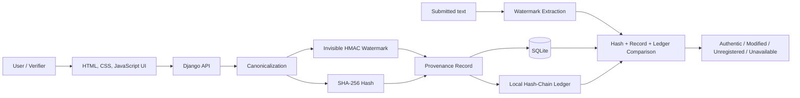

# TextSeal - Final-Year BE Project Guide

## 1. Project identity

| Item | Final content |
| --- | --- |
| Project title | **TextSeal: AI Text Watermarking and Provenance Verification System** |
| Domain | Artificial Intelligence, NLP, Cyber Security, Blockchain |
| Target users | Students, educators, content creators, media organizations, and general verifiers |
| Project type | Full-stack web application and academic prototype |
| Implementation | Django, Python, SQLite, HTML, CSS, JavaScript |
| Primary outcome | A clear, evidence-based authenticity or tampering result for registered text |

## 2. Abstract

The increasing use of AI-generated text has created a need to verify a document's origin and integrity. TextSeal is a web-based system that embeds an invisible signed watermark into text, creates a SHA-256 fingerprint, and registers provenance metadata. During verification, the system extracts the watermark, retrieves the related record, checks the hash, and validates the provenance ledger. It reports whether the content is authentic and unchanged, modified, unregistered, or unavailable for safe verification.

The project demonstrates the complete provenance workflow locally. Its ledger is a tamper-evident hash chain, clearly labelled as a local academic prototype. It does not falsely claim that a record was written to Polygon or Ethereum. A real smart-contract adapter can replace this component after the group finalizes the contract ABI, RPC provider, gas policy, and secret-management process.

## 3. Problem statement

AI-generated content is easy to copy, modify, and falsely attribute. Conventional AI-detection tools estimate whether writing appears AI-generated, but cannot prove a particular registered text's integrity or source. TextSeal addresses this gap through embedded watermarking, cryptographic hashing, provenance registration, and verification.

## 4. Objectives

1. Accept text entered directly or uploaded as a UTF-8 `.txt` or `.md` file.
2. Produce a hidden, signed watermark without changing the text's visible readability.
3. Generate a deterministic SHA-256 fingerprint from canonical text.
4. Register text ID, timestamp, model information, source note, fingerprint, and ledger reference.
5. Detect the watermark and compare the submitted text with its registered provenance record.
6. Detect visible text modifications and communicate a trustworthy verification outcome.
7. Maintain a reviewable verification trail and local tamper-evident ledger.

## 5. Architecture



### Module responsibilities

| Module | Main file | Responsibility |
| --- | --- | --- |
| UI | `textseal/core/templates/core/index.html` | Text input, results, activity history |
| API | `textseal/core/views.py` | Input validation and workflow orchestration |
| Watermarking | `textseal/core/watermark.py` | Canonicalization, HMAC token generation, embedding, extraction |
| Integrity | `textseal/core/watermark.py` | SHA-256 content fingerprint |
| Provenance | `textseal/core/models.py` | Registered text and verification audit records |
| Ledger | `textseal/core/ledger.py` | Hash-chain append and validation |
| Persistence | `db.sqlite3` | Local academic demonstration database |

## 6. Watermark algorithm used in this prototype

1. The submitted text is normalized to Unicode NFC, consistent newlines, trimmed line endings, and no watermark characters.
2. A UUID text ID is generated.
3. An HMAC-SHA-256 signature of that ID is created using the server-side `TEXTSEAL_WATERMARK_SECRET`.
4. The payload `TS1|text_id|signature` is encoded as invisible zero-width Unicode characters and appended to the visible text.
5. The canonical visible text is hashed with SHA-256.
6. The ID, signature token, hash, metadata, and ledger block are saved.

This method makes a clean, explainable proof-of-concept. It is not robust against paraphrasing, aggressive Unicode sanitization, or tools that strip zero-width characters; this limitation must be stated honestly in the project report and viva.

## 7. Functional requirement traceability

| PRD ID | Evidence in TextSeal |
| --- | --- |
| FR-01 Text Input | Text area plus `.txt`/`.md` upload |
| FR-02 Preprocessing | `canonicalize()` function |
| FR-03 Watermark Generation | UUID + HMAC token generation |
| FR-04 Watermark Embedding | Zero-width payload embedding |
| FR-05 Hash Generation | SHA-256 of canonical visible text |
| FR-06 Provenance Registration | `TextRecord` and metadata persistence |
| FR-07 Blockchain Record | Transparent local hash-chain demonstration; production Polygon/Ethereum adapter pending approved ABI |
| FR-08 Watermark Detection | `extract()` function |
| FR-09 Provenance Retrieval | `/api/provenance/<text_id>` endpoint and verification lookup |
| FR-10 Authenticity Check | Token, hash, record, and ledger comparison |
| FR-11 Modification Detection | Hash mismatch produces `modified` |
| FR-12 Verification Result | Clear result panel and audit activity history |

## 8. Database design

| Entity | Main fields | Purpose |
| --- | --- | --- |
| `TextRecord` | text ID, hash, token, model, note, length, reference, timestamp | Registered provenance record |
| `LedgerBlock` | index, previous hash, payload hash, block hash | Tamper-evident local ledger block |
| `VerificationRecord` | verification ID, text record, submitted hash, result, timestamp | Verification audit trail |

The system does not persist the original text in the database. This reduces unnecessary content retention; only the proof data and metadata are stored.

## 9. API endpoints

| Method | Endpoint | Use |
| --- | --- | --- |
| `POST` | `/api/watermark` | Embed watermark and create a provenance record |
| `POST` | `/api/verify` | Verify submitted watermarked text |
| `GET` | `/api/provenance/<text_id>` | Retrieve one provenance record |
| `GET` | `/api/history` | Show recent registrations, verification events, and ledger health |
| `GET` | `/api/health` | Confirm server and ledger availability |

## 10. Expected verification outcomes

| Result | Meaning |
| --- | --- |
| Authentic & unchanged | Signed watermark exists, record exists, SHA-256 matches, and ledger is valid |
| Modified / tampered | Registered watermark exists but visible canonical text hash has changed |
| Not registered | No supported watermark, or no matching local record exists |
| Watermark invalid | Hidden payload was altered or lacks a valid HMAC signature |
| Verification unavailable | Ledger is inconsistent or unavailable; the system refuses a false authenticity claim |

## 11. Suggested group work allocation

Adapt this to your actual group members; every member should understand the complete flow.

| Role | Demonstrable contribution |
| --- | --- |
| Backend and database member | Django models, API endpoints, migrations, input validation |
| Security and NLP member | Canonicalization, HMAC watermark, SHA-256 comparison, limitations study |
| Frontend member | Responsive UI, result states, upload flow, ledger history view |
| Blockchain and testing member | Hash-chain ledger, future Polygon research, test cases, demo data, report diagrams |

## 12. Build and run

```powershell
cd "C:\Users\Poonam Pawar\Documents\Codex\2026-09-20\i-x20"
.\.venv\Scripts\python.exe -m pip install -r requirements.txt
.\.venv\Scripts\python.exe manage.py migrate
.\.venv\Scripts\python.exe manage.py runserver
```

Open `http://127.0.0.1:8000`.

Run the test suite before each review:

```powershell
.\.venv\Scripts\python.exe manage.py test
```

## 13. Project review checklist

- [ ] Update the title page with college name, guide name, group names, and PRN numbers.
- [ ] Replace sample model/source information with your own demo scenario.
- [ ] Demonstrate an authentic result, a one-word tampering result, and an unrelated text result.
- [ ] Open **Review ledger** and explain the block index, previous hash, payload hash, and block hash.
- [ ] Explain that this is a local hash-chain proof-of-concept, not a live public blockchain transaction.
- [ ] Run `manage.py test` and retain the passing output for evidence.
- [ ] Capture screenshots for the report after populating a few records.
- [ ] State watermark limitations and future work without overclaiming robustness.

## 14. Future scope

1. Integrate a finalized Polygon/Ethereum smart contract that stores only the text ID and hash.
2. Add institutional user authentication and role-based access.
3. Add configurable server-side LLM generation through an approved provider.
4. Research statistical LLM watermarking for better paraphrase resilience.
5. Move from SQLite to PostgreSQL/MySQL with encrypted backups and HTTPS deployment.
